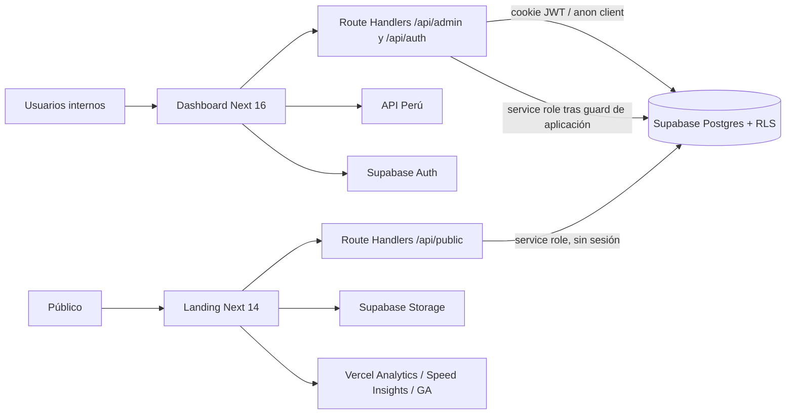
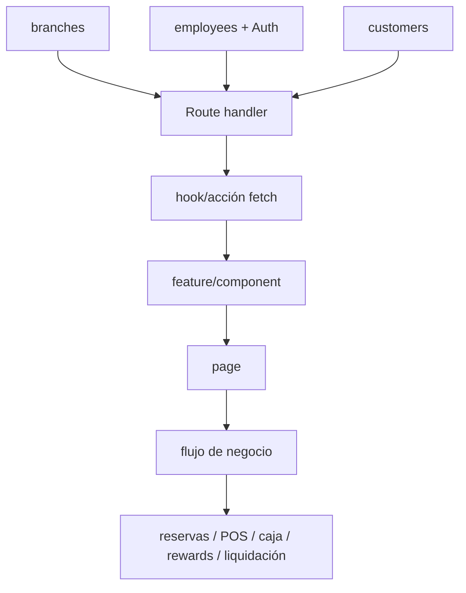

# Arquitectura real

## Vista general

No es un workspace formal. Un `package.json` raíz delega a dos aplicaciones npm independientes:

- Dashboard: `lbbs_Dash_v2/lbbs-v2`, Next.js 16.2.10, React 19, Tailwind 4.
- Landing: `lbbs_landing_v2`, Next.js 14.2.35, React 18, Tailwind 3.

Ambas usan exactamente el mismo URL, anon key y service-role key de Supabase (comparación local sin revelar valores). Comparten Postgres, Auth/Storage a nivel de proyecto y tablas con nombres solapados, pero sus contratos de datos pertenecen a generaciones incompatibles.

## Dashboard

App Router. Las páginas bajo `/control` usan `getModuleAccess`; el layout valida sesión y cambio obligatorio de contraseña. `proxy.ts` refresca cookies y protege de forma temprana `/control`, pero la autorización definitiva vive en layouts, route handlers, RPC y RLS. `/pos` tiene layout visual propio y depende de APIs protegidas.

La UI usa React Query de forma selectiva; muchos módulos usan `fetch`, estado local y recarga manual. No existe ORM ni capa DTO/schema central. Los handlers llaman Supabase directamente. Las operaciones críticas usan RPC PostgreSQL, aunque checkout prepara venta/items/pagos con varias llamadas antes de `complete_sale`.

## Landing

App Router con páginas públicas y endpoints que usan `createAdminClient` (service role). El home obtiene todo mediante `getLandingData`; las rutas `/reservar`, `/agenda`, `/cliente/asistencias` y `/cliente/resena` consumen `/api/public/*`.

El contenido depende de `services`, `employees`, `branches`, `customer_reviews`, `landing_assets`, `app_settings` y Storage. Reservas/asistencias dependen además del esquema heredado (`starts_at`, `employee_id`, estados en español, schedules y reward accounts).

## Datos y despliegue

- Bootstrap canónico actual: `dash/src/sql/000_production_bootstrap.sql`, generado desde scripts históricos seleccionados.
- Linaje heredado: `lbbs_Dash_v2/supabase/sql/*.sql`; la landing todavía lo consume.
- No hay migraciones versionadas/aplicadas por CLI: instalación manual en SQL Editor.
- No se encontró configuración CI/CD ni `vercel.json`; los README describen Vercel.
- Cron, realtime, push y storage aparecen solo en SQL heredado, no en el bootstrap canónico actual.

## Flujos físicos

La arquitectura real no siempre tiene service/hook intermedio: numerosos componentes llaman directamente a endpoints y estos a Supabase.
