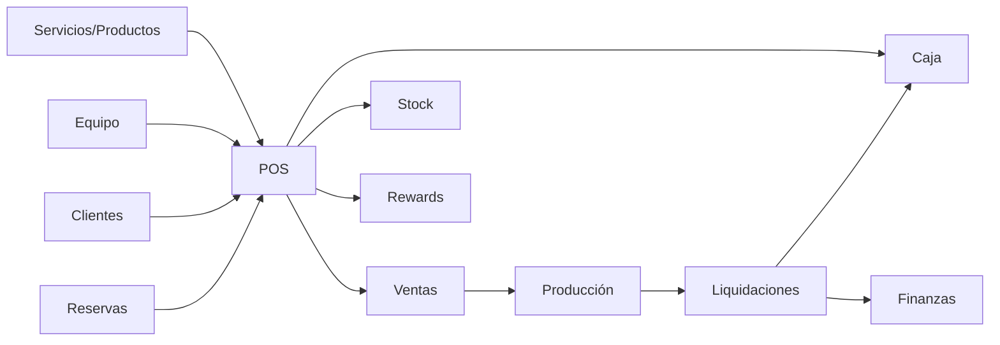

# Módulos del dashboard

Roles reales: `owner`, `admin`, `reception`, `barber`, `viewer`. La tabla resume UI, API/datos, permisos y efectos. Los CRUD de catálogos usan GET/POST/PUT; no hay DELETE de negocio en UI, se usa `is_active`.

| Módulo | Ruta/UI | API y datos principales | Roles/Reglas/side effects |
| --- | --- | --- | --- |
| Auth/cuenta | login, recuperación, reset, cambio obligatorio, `/control/mi-cuenta` | `/api/auth/*`; Auth, `employees`, `audit_logs` | sesión Supabase; política de contraseña; bloqueo `must_change_password` parcial |
| Control/KPI | `/control` `ControlKpis` | `/api/admin/control/kpis`; sales/items/payments/POS/employees | todos ven módulo, datos según rol/sede |
| Sedes | `/control/sedes`, forms/table | `/api/admin/branches`; `branches` | owner/admin; alta/edición/activación |
| Equipo | `/control/equipo` | employees, auth.admin, employee-finance | owner/admin UI; crea cuenta opcional; recepción puede invocar beneficio/insumo por API/RPC |
| Caja | `/control/caja` | cash bootstrap/movements/cancel; `cash_movements`, categories, POS | owner/admin/reception; RPC transaccionales, alcance por sede |
| POS | `/control/pos`, `/pos`, 34 archivos | bootstrap, session open/close, checkout, cancel, tickets; 12+ tablas | owner/admin/reception; carrito local; venta, stock, rewards, producción y reserva |
| Ventas | `/control/ventas` | `/api/admin/sales*`; sales/items/payments/snapshots | owner/admin/reception; historial, detalle, ticket, cancelación |
| Reservas | `/control/reservas` | reservations, notes, contact, pos | owner/admin/reception; barber lectura/notas propias por RLS; estados y coordinación |
| Clientes | `/control/clientes` | customers/search/lookup-document; API Perú/cache/log | owner/admin/reception; clientes globales; normalización y deduplicación parcial |
| Contactos | `/control/contactos` | contacts, templates, logs, reservations/sales | owner/admin/reception; abre WhatsApp y registra intento |
| Servicios | `/control/servicios` | services/categories/branch-prices | owner/admin; precio base/especial, custom price |
| Productos/stock | `/control/productos` | products/categories/units/branch-prices/stock-movements | catálogos owner/admin; stock también reception en su sede |
| Rewards | `/control/rewards` | rules, benefits, ledger, entitlements, redemptions, migrations | configuración admin; operación owner/admin/reception; cliente genérico excluido |
| Producción | `/control/produccion` | generate RPC; production/bonus/debts/periods | owner/admin; derivada de ventas completadas |
| Liquidaciones | `/control/liquidaciones` | prepare/review/transition/pay RPC | owner/admin; snapshots, deuda, caja y ledger financiero |
| Finanzas | `/control/finanzas` | finance manual entries/categories/methods/branches | owner/admin; alta y anulación lógica |
| Simulaciones | `/control/simulaciones-pago` | empleados + cálculo cliente | owner/admin; no persiste |
| Configuración | `/control/configuracion` | payment methods, reasons, categories, rules, templates | owner/admin; maestros que afectan POS/caja/rewards |
| Dispositivos | `/control/dispositivos` | sin API | placeholder, owner/admin |
| Hotspots | `/control/hotspots` | sin API | placeholder, owner/admin |
| Deudas empleados | `/control/deudas-empleados` | sin API propia | placeholder; flujo real está en Equipo |
| QA interno | sin navegación normal | `/api/admin/qa/*`, tablas QA | owner + flags; puede limpiar datos QA |

## Dependencias críticas entre módulos

## Estado y validación

La validación es manual por handler; no hay Zod/Valibot ni DTOs generados. DB/RPC protege las operaciones críticas mejor que los formularios, pero quedan divergencias (cortesía sin motivo, contratos landing y algunos guards que dependen solo de RLS).
