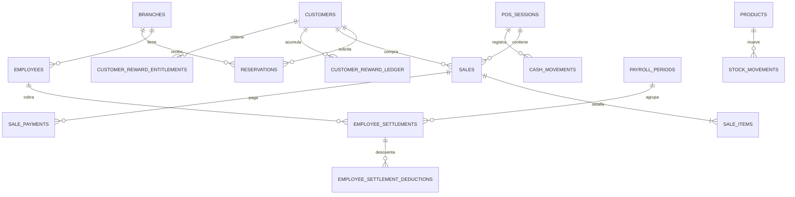

# Auditoría de base de datos

## Fuentes de verdad encontradas

| Linaje | Archivos | Tablas | Funciones | Policies | Estado |
| --- | ---: | ---: | ---: | ---: | --- |
| canónico dashboard `src/sql` | 71 SQL | 63 | 62 | 157 | bootstrap manual actual |
| heredado `lbbs_Dash_v2/supabase/sql` | 49 | 40 | 11 | 80 | aún consumido por landing |

No hay historial de migraciones aplicado por CLI ni tabla de versión controlada desde el repo. `000_production_bootstrap.sql` es una concatenación para base limpia; los parches posteriores deben regenerarlo. Esto dificulta reproducir el esquema de una base existente.

## Modelo canónico resumido

Entidades: sedes/equipo, catálogos/precios, clientes/reservas, POS/ventas/pagos/documentos, stock, caja/finanzas, rewards, producción/deudas/beneficios/liquidaciones, configuración/contacto, identidad/auditoría y QA.

## Integridad positiva

- FK extensivas, RLS habilitado y policies separadas por rol/sede.
- Índices para FK, estados, fechas y búsquedas principales.
- Unique para usuario-empleado, códigos, precios por sede, idempotencia checkout y una venta completada por reserva.
- RPC críticas con `security definer`, `search_path` fijo, locks y checks de rol.
- Triggers recalculan totales/producción; vistas centralizan stock, precio y rewards.

## Riesgos de integridad

1. Diez tablas compartidas tienen definiciones incompatibles entre linajes: branches, employees, customers, services, reservations, app_settings, audit_logs, customer_reward_ledger, products y whatsapp_templates.
2. `app_role` heredado (`admin/recepcion/barbero`) y canónico (`owner/admin/reception/barber/viewer`) no pueden coexistir limpiamente.
3. Reserva canónica usa fecha/hora y estados ingleses; landing usa timestamps/estados españoles. El check canónico rechaza inserts heredados en base limpia.
4. Landing usa `normalized_phone`; dashboard `phone_normalized`. Esto favorece duplicados o errores.
5. No existe constraint DB de no-solapamiento para reservas públicas; check-then-insert es vulnerable a concurrencia.
6. La razón de cortesía es nullable y backend sustituye una razón genérica; la regla auditada por test no está en DB.
7. Checkout reparte preparación en múltiples transacciones HTTP/REST y compensa con deletes.
8. `audit_logs` canónico no recibe auditoría genérica por trigger; la mayoría de CRUD maestros no guardan before/after.

## SQL destructivo/operativo

`120_restore_operational_base_seed.sql`, `121_purge_all_except_owner.sql`, resets legacy y `dev/098_*` eliminan datos. Poseen guardas/comentarios, pero no deben formar parte de instalación ni ejecución automatizada. Los endpoints QA también pueden limpiar datos, aunque exigen owner y flags.

## Pendiente externo

Validar en un clon no productivo: esquema remoto exacto, orden aplicado, policies efectivas, grants, índices reales, Storage buckets y diferencia entre bootstrap y producción. No se ejecutó SQL ni se modificó Supabase.
