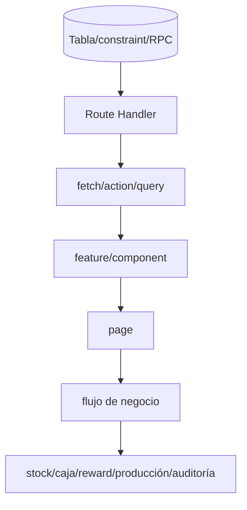

# Matriz de dependencias e impacto

| Si cambia... | Tablas/RPC | APIs | UI/Flujos afectados | Landing |
| --- | --- | --- | --- | --- |
| branches | branches, scope RLS | casi todos los módulos | filtros, caja, POS, empleados | sedes, contacto, reserva, imágenes |
| employees/roles | Auth, RLS helpers | auth, employees, POS, reservations, production | login, permisos, barbero, liquidación | equipo/opciones; contrato incompatible |
| customers | rewards/reservations/sales | customers, lookup, POS, rewards | alta/búsqueda/venta | reserva/asistencias/reseñas |
| services | prices, production | services, POS, reservations | catálogo, venta, comisión | catálogo/reserva |
| products | stock/prices/bonus | products, stock, POS | inventario, cortesía, insumo | legado analytics/rewards muerto |
| reservations | notes/sales | admin reservations/POS | coordinación y venta | agenda/availability/create; alto riesgo |
| POS sessions | sales/cash | POS/cash/settlement | apertura, venta, cierre, pago cash | independiente |
| sales/items/payments | stock/rewards/production/snapshots | checkout/sales/ticket | dinero, inventario, rewards, nómina | visits legacy independiente |
| cash movements | sessions/settlements/finance | cash/settlements | conciliación | independiente |
| rewards | ledger/entitlements/redemptions | rewards/checkout | descuentos/fidelización | sistema legacy distinto |
| production/payroll | settlements/debts | production/settlements | pago empleados | independiente |
| app_settings | config | settings | reglas globales | perfil/links; formato divergente |
| audit_logs | seguridad/trazabilidad | auth y landing audit | investigación | formato incompatible |
| Storage | buckets/paths | landing-data | sin UI actual | hero, galería, sedes, avatares |

## Cadena de impacto principal

Para POS, cualquier cambio en servicios, productos, empleados, clientes, pagos, sesiones, cortesías o rewards puede afectar checkout y, transitivamente, stock, caja, producción, liquidaciones y tickets. Para landing, cualquier cambio en las diez tablas solapadas debe considerarse regresión pública hasta completar la migración de contrato.
